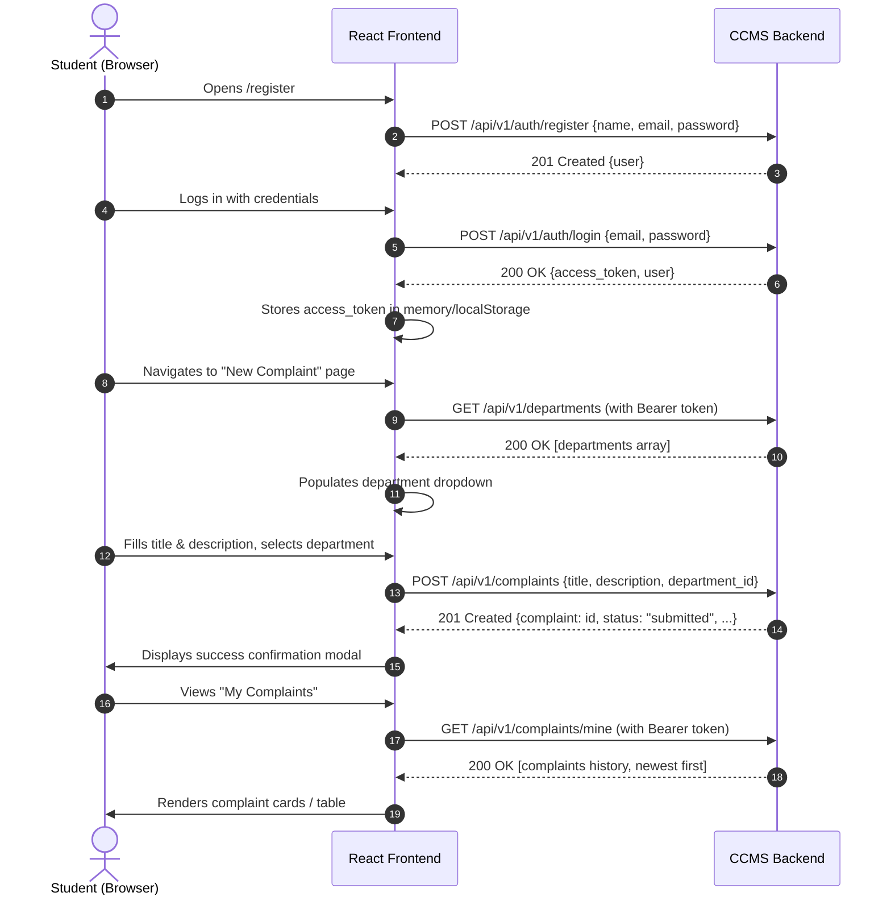

# Frontend Team Integration & Handoff Guide (Sprint 1)

> **Sprint 1 final update (2026-10-14):** the React app in `frontend/` now implements this contract:
> typed client in `frontend/src/api/`, routes in `frontend/src/App.tsx`, auth/session logic in
> `frontend/src/context/AuthContext.tsx`. Registration does **not** sign the student in; it redirects to
> `/login`.

Welcome to the **Campus Complaint Management System (CCMS)** frontend integration package.
This document provides everything the frontend team (React + TypeScript) needs to start building user interfaces, integrating state management, and connecting to the backend API without ambiguity.

---

## 1. Quick Reference & Endpoints

| Resource | URL | Notes |
| :--- | :--- | :--- |
| **API Base URL** | `http://localhost:8000` | Default local backend port |
| **API Version Prefix** | `/api/v1` | All domain endpoints are prefixed with this |
| **Interactive Swagger UI** | `http://localhost:8000/docs` | Live testing with Authorization dialog |
| **ReDoc Documentation** | `http://localhost:8000/redoc` | Clean contract & schema reference |
| **OpenAPI Schema (JSON)** | `http://localhost:8000/openapi.json` | Can be used with OpenAPI TypeScript generators (`openapi-typescript`, `orval`) |
| **Postman Test Collection** | `backend/requests/ccms-local.postman_collection.json` | Pre-configured with automatic token capture |

---

## 2. Sprint 1 Implementation Scope

### Implemented & Ready for Integration:
1. **Student Account Registration**: `POST /api/v1/auth/register` (public, restricted strictly to `student` role; protected by in-process rate limiting).
2. **User Authentication & Login**: `POST /api/v1/auth/login` (generates standard JWT Bearer token; protected by in-process rate limiting).
3. **Current User Profile**: `GET /api/v1/users/me` (returns safe identity, email, and role).
4. **Role-Based Authorization Guards**: Backend rejects unauthorized roles on protected endpoints.
5. **Department Catalog Lookup**: `GET /api/v1/departments` (alphabetically sorted list of active departments).
6. **Student Complaint Submission**: `POST /api/v1/complaints` (validates active department, persists record in DB).
7. **Personal Complaint History**: `GET /api/v1/complaints/mine` (isolated to authenticated student, newest first, supports `limit` and `offset` pagination).
8. **Advisory Department Suggestions**: `POST /api/v1/departments/suggest` (advisory keyword heuristic recommendations based on draft text; student always retains final authority).

### Deferred to Later Sprints (Do NOT build UI expectations for these yet):
- Staff complaint triage, status progression (`in_progress`, `resolved`, `rejected`), and staff assignment.
- Resolution notes, escalation workflows, email notifications.
- File and image attachments.
- Public tracking numbers or public dashboards.
- Analytics and department performance heatmaps.

---

## 3. Connecting From Your Frontend Application

### 3.1 — Environment Variable Setup
In your frontend React app (e.g. `.env.local` for Vite):
```env
VITE_API_BASE_URL=http://localhost:8000
# The value is the backend ORIGIN. The API client adds /api/v1 itself.
# (A trailing /api/v1 is tolerated and stripped, so the prefix is never duplicated.)
```

### 3.2 — CORS Configuration
The backend is pre-configured to accept requests from:
- `http://localhost:3000`
- `http://localhost:5173`
- `http://127.0.0.1:3000`
- `http://127.0.0.1:5173`

If your local dev server runs on another port, add it to `CORS_ORIGINS` in `backend/.env`.

### 3.3 — Sending Bearer Tokens
All protected endpoints expect the access token in the `Authorization` header:
```http
Authorization: Bearer <your_jwt_access_token>
```

### 3.4 — Session Management & Sign-Out
The backend uses stateless JWTs. Sign-out should be handled completely on the frontend client:
- Delete the stored access token from memory / storage (`localStorage` / secure cookie).
- Redirect the student to `/login`.
- Clear the global user state.
*Do not call any backend logout route; none is required for stateless JWTs.*

---

## 4. Role-Based Access Matrix

| Role | Permitted Actions in Sprint 1 | Forbidden Actions |
| :--- | :--- | :--- |
| **Guest / Anonymous** | Register student account, Login, System Health | Accessing current user profile, departments, complaints |
| **Student** | View own profile (`/users/me`), View departments (`/departments`), Lodge complaint (`/complaints`), View own history (`/complaints/mine`), Get department suggestion (`/departments/suggest`) | Attempting to register staff/admin accounts |
| **Staff** | View own profile (`/users/me`) | Filing complaints or viewing student complaint history (HTTP 403) |
| **Admin** | View own profile (`/users/me`) | Filing complaints or viewing student complaint history (HTTP 403) |

---

## 5. Department Handling Rules (CRITICAL FOR FRONTEND)

> [!IMPORTANT]
> **DO NOT HARDCODE DEPARTMENT IDs IN FRONTEND CODE.**
> Department records are dynamic and provisional. The frontend must fetch active departments from `GET /api/v1/departments` and populate dropdowns/select components using the returned `id` and `name`.

### Official Campus Departments Catalog:
The database seeds with the official DAU departments:
1. `Hostel`
2. `IT Services`
3. `Library`
4. `Mess & Cafeteria`
5. `Sports & Gymnasium`
6. `Campus Security`
7. `Medical Facility`

*Note: By fetching dynamically from the API (`GET /api/v1/departments`), the frontend dropdowns always reflect the database records.*

---

## 6. Detailed API Requests & Responses

### 6.1 — Register Student Account
- **Endpoint**: `POST /api/v1/auth/register`
- **Auth**: None (Public)
- **Status Code**: `201 Created`

**Request Body:**
```json
{
  "name": "Aarav Patel",
  "email": "aarav.patel@student.university.edu",
  "password": "SecurePassword123!"
}
```

**Response Body (201 Created):**
```json
{
  "id": 1,
  "name": "Aarav Patel",
  "email": "aarav.patel@student.university.edu",
  "role": "student",
  "is_active": true,
  "department_id": null,
  "created_at": "2026-10-01T00:30:00Z"
}
```

**Error Scenarios:**
- `409 Conflict`: Email already registered (`{"detail": "An account with this email address already exists."}`)
- `422 Unprocessable Content`: Validation failure (name < 2 chars, password < 8 chars, invalid email format, or forbidden fields).

---

### 6.2 — Login
- **Endpoint**: `POST /api/v1/auth/login`
- **Auth**: None (Public)
- **Status Code**: `200 OK`

**Request Body:**
```json
{
  "email": "aarav.patel@student.university.edu",
  "password": "SecurePassword123!"
}
```

**Response Body (200 OK):**
```json
{
  "access_token": "eyJhbGciOiJIUzI1NiIsInR5cCI6IkpXVCJ9...",
  "token_type": "bearer",
  "expires_in": 86400,
  "user": {
    "id": 1,
    "name": "Aarav Patel",
    "email": "aarav.patel@student.university.edu",
    "role": "student",
    "is_active": true,
    "department_id": null,
    "created_at": "2026-10-01T00:30:00Z"
  }
}
```

**Error Scenarios:**
- `401 Unauthorized`: Bad email or password (`{"detail": "Invalid email or password."}`). Does not disclose whether email exists.
- `403 Forbidden`: Account deactivated (`{"detail": "Account is inactive. Please contact system administrator."}`).

---

### 6.3 — Google Sign-In & Ticket Exchange

Google Sign-In uses an Authorization Code Flow with PKCE S256 and single-use postMessage handoff tickets.

#### Step 1: Start Flow & Obtain Google Auth URL
- **Endpoint**: `POST /api/v1/auth/google/start`
- **Auth**: None (Public)
- **Headers**: `Origin: <frontend-origin>`

Generate a 32-byte cryptographically random verifier and its SHA-256 base64url challenge in memory via Web Crypto:
```typescript
const clientVerifier = bufferToBase64Url(crypto.getRandomValues(new Uint8Array(32)));
const clientChallenge = bufferToBase64Url(await crypto.subtle.digest('SHA-256', new TextEncoder().encode(clientVerifier)));
```
Send `client_challenge` to the backend:
```json
{
  "client_challenge": "dBjftJeZ4CVP-mB92K27uhbUJU1p1r_wW1gFWFOEjXk"
}
```
**Response (200 OK):**
```json
{
  "authorization_url": "https://accounts.google.com/o/oauth2/v2/auth?client_id=...",
  "state": "opaque-state-token"
}
```

#### Step 2: Open Popup & Listen for postMessage
Open `authorization_url` synchronously from the user's click in a popup window:
```typescript
const popup = window.open(authUrl, 'google_login_popup', 'width=500,height=600');
```
Listen for message from the backend callback:
```typescript
window.addEventListener('message', (event) => {
  // STRICT: Verify exact backend origin and popup source
  if (event.origin !== 'http://localhost:8000') return;
  if (event.source !== popup) return;

  if (event.data?.type === 'CCMS_GOOGLE_AUTH_SUCCESS') {
    const ticket = event.data.ticket;
    // Proceed to Step 3: Exchange ticket
  } else if (event.data?.type === 'CCMS_GOOGLE_AUTH_ERROR') {
    // Handle error or account linking prompt
  }
});
```

#### Step 3: Exchange Handoff Ticket with Proof
- **Endpoint**: `POST /api/v1/auth/google/exchange`
- **Auth**: None (Public)
- **Headers**: `Origin: <frontend-origin>`

**Request Body:**
```json
{
  "ticket": "4f8b9e...",
  "client_verifier": "dBjftJeZ4CVP-mB92K27uhbUJU1p1r_wW1gFWFOEjXk"
}
```
**Response Body (200 OK):**
Standard CCMS `TokenResponse`:
```json
{
  "access_token": "eyJhbGciOiJIUzI1NiIsInR5cCI6IkpXVCJ9...",
  "token_type": "bearer",
  "expires_in": 86400,
  "user": {
    "id": 2,
    "name": "Google Student",
    "email": "student@campus.edu",
    "role": "student",
    "is_active": true,
    "department_id": null,
    "created_at": "2026-10-12T14:00:00Z",
    "email_verified": true,
    "email_verified_at": "2026-10-12T14:00:00Z"
  }
}
```

---

### 6.4 — Get Current Authenticated Profile
- **Endpoint**: `GET /api/v1/users/me`
- **Auth**: `Bearer <token>`
- **Status Code**: `200 OK`

**Response Body (200 OK):**
```json
{
  "id": 1,
  "name": "Aarav Patel",
  "email": "aarav.patel@student.university.edu",
  "role": "student",
  "is_active": true,
  "department_id": null,
  "created_at": "2026-10-01T00:30:00Z"
}
```

---

### 6.4 — List Active Departments
- **Endpoint**: `GET /api/v1/departments`
- **Auth**: `Bearer <token>`
- **Status Code**: `200 OK`
- **Sorting**: Deterministic alphabetical order by name

**Response Body (200 OK):**
```json
[
  {
    "id": 6,
    "name": "Estate & Facility Management",
    "description": "Classroom electrical fixtures, campus lighting, sanitation, landscaping, and elevators.",
    "is_active": true
  },
  {
    "id": 1,
    "name": "Hostel",
    "description": "Hostel room maintenance, plumbing, furniture, and residential living conditions.",
    "is_active": true
  },
  {
    "id": 2,
    "name": "IT Services",
    "description": "Campus Wi-Fi connectivity, LAN ports, student portal access, and computer lab equipment.",
    "is_active": true
  },
  {
    "id": 3,
    "name": "Library",
    "description": "Book cataloging, reading room facilities, air conditioning, and digital archive access.",
    "is_active": true
  },
  {
    "id": 4,
    "name": "Mess & Cafeteria",
    "description": "Dining hall food quality, hygiene standards, catering services, and drinking water.",
    "is_active": true
  },
  {
    "id": 5,
    "name": "Sports & Gymnasium",
    "description": "Sports grounds, gymnasium equipment, indoor sports arenas, and equipment reservations.",
    "is_active": true
  }
]
```

---

### 6.5 — Submit Complaint
- **Endpoint**: `POST /api/v1/complaints`
- **Auth**: `Bearer <token>` (Student role only)
- **Status Code**: `201 Created`

**Validation Rules:**
- `title`: String, 3 to 120 characters (whitespace trimmed, cannot be blank).
- `description`: String, 10 to 2000 characters (whitespace trimmed, cannot be blank).
- `department_id`: Integer, positive ID of an **active** department.

**Request Body:**
```json
{
  "title": "Wi-Fi not working in hostel",
  "description": "The Wi-Fi connection has been unavailable since this morning in Block B room 302.",
  "department_id": 2
}
```

**Response Body (201 Created):**
```json
{
  "id": 101,
  "title": "Wi-Fi not working in hostel",
  "description": "The Wi-Fi connection has been unavailable since this morning in Block B room 302.",
  "department_id": 2,
  "department_name": "IT Services",
  "created_by_id": 1,
  "status": "submitted",
  "created_at": "2026-10-01T00:35:12.345678Z"
}
```

**Error Scenarios:**
- `400 Bad Request`: Department is inactive (`{"detail": "Department 'Printing Press' is currently inactive and cannot receive complaints."}`)
- `403 Forbidden`: Non-student user attempting to file a complaint.
- `404 Not Found`: Department ID does not exist (`{"detail": "Department with ID 999 does not exist."}`).
- `422 Unprocessable Content`: Validation failure (title or description too short/long or blank).

---

### 6.6 — Personal Complaint History
- **Endpoint**: `GET /api/v1/complaints/mine`
- **Auth**: `Bearer <token>` (Student role only)
- **Status Code**: `200 OK`
- **Query Parameters**:
  - `limit` (integer, optional): Maximum items to return. Default: `50`, Max: `100`.
  - `offset` (integer, optional): Number of items to skip for pagination. Default: `0`.
- **Sorting**: Newest complaints first (`created_at DESC, id DESC`)

**Response Body (200 OK):**
```json
[
  {
    "id": 101,
    "title": "Wi-Fi not working in hostel",
    "department_name": "IT Services",
    "status": "submitted",
    "created_at": "2026-10-01T00:35:12.345678Z"
  }
]
```

*Note: Returns empty array `[]` if the student has no complaints (or offset exceeds count).*

---

### 6.7 — Advisory Keyword-Based Department Suggestion
- **Endpoint**: `POST /api/v1/departments/suggest`
- **Auth**: `Bearer <token>` (Student role only)
- **Status Code**: `200 OK`

> [!NOTE]
> This service is a **keyword-based advisory heuristic** with no vector database or external model. It inspects drafted text against campus keywords and returns provisional recommendations. Suggestions are strictly advisory; students always retain final manual choice.

**Request Body:**
```json
{
  "title": "Bathroom tap dripping",
  "description": "The washroom tap in room 204 has a constant water leak."
}
```

**Response Body (200 OK):**
```json
{
  "status": "provisional_advisory",
  "version": "v1.0.0-heuristic",
  "suggestions": [
    {
      "department_id": 1,
      "department_name": "Hostel",
      "confidence_score": 0.90,
      "rationale": "Matched keywords relating to Hostel: tap, washroom"
    }
  ],
  "disclaimer": "Advisory suggestions are keyword-based heuristics. The complainant retains final authority to select their preferred department."
}
```

**Frontend Status Handling Guide:**
- `status === "provisional_advisory"`: Clear department candidate found. Show top suggestion.
- `status === "uncertain"`: The heuristic cannot confidently identify one winner.
  - When candidates are tied/close: `suggestions` contains the candidates. Frontend should display: *"Multiple departments may apply; please choose:"* and present candidate buttons.
  - When no keywords match: `suggestions` is `[]`. Frontend should display: *"No automated suggestion available; please select a department manually."*
- `status === "error_fallback"`: An internal error occurred in the suggestion heuristic (`suggestions: []`). Frontend should fall back gracefully to the standard department dropdown.

*Crucial rule:* Department suggestion failure must NEVER block the student from manually choosing a department and lodging a complaint.

---

## 7. Standard Error Response Structure

All backend error responses follow a consistent format:

### Standard Error (400, 401, 403, 404, 409, 500)
```json
{
  "detail": "Detailed human-readable explanation of what went wrong"
}
```

### Rate Limit Error (429 Too Many Requests)
```json
{
  "detail": "Rate limit exceeded. Try again in 60 seconds."
}
```
*Check `Retry-After` header to inform the user how long to wait.*

### Validation Error (422 Unprocessable Content)
```json
{
  "detail": [
    {
      "field": "body -> title",
      "message": "Title must contain at least 3 non-whitespace characters",
      "type": "value_error"
    }
  ]
}
```

---

## 8. Complete Student User Journey Walkthrough



---

## 9. Frontend Integration Checklist

- [ ] Create an API client instance (e.g. `axios` or `fetch` wrapper) pointing to `VITE_API_BASE_URL`.
- [ ] Implement an auth interceptor that attaches `Authorization: Bearer ${token}` to protected requests.
- [ ] Build the Student Registration screen (`POST /api/v1/auth/register`).
- [ ] Build the Login screen (`POST /api/v1/auth/login`) and store the returned token.
- [ ] Build the Navigation bar showing user profile (`GET /api/v1/users/me`) and Logout action (clear token).
- [ ] Build the Complaint Submission form:
  - Dynamically fetch departments via `GET /api/v1/departments`.
  - Validate 3–120 characters on title and 10–2000 characters on description before submit.
  - Optional advisory assist: Call `POST /api/v1/departments/suggest` on draft blur/change to recommend a department.
- [ ] Build the "My Complaints" history page (`GET /api/v1/complaints/mine`) rendering status badges (`submitted`) and handling pagination.
- [ ] Handle error responses (401 redirects to `/login`, 422 displays inline form field validation messages, 429 shows retry countdown).
- [ ] **XSS Defense**: The backend stores and returns complaint text as inert raw data. React automatically escapes strings rendered in JSX (`<div>{complaint.title}</div>`). Frontend developers must **never** use `dangerouslySetInnerHTML` on complaint title or description fields.
- [ ] **Security Headers Note**: The backend emits `X-Content-Type-Options: nosniff`, `Referrer-Policy: no-referrer`, and `Cache-Control: no-store` on authenticated endpoints. Full application Content Security Policy (CSP), frame-ancestors, and HSTS are the responsibility of the frontend hosting server / reverse proxy.

---

## 10. Sample Test Credentials for Development

If you ran the seed script (`python -m app.scripts.seed_dev_users`), the following accounts exist:
- **Admin**: `admin@campus.edu` / `AdminSecret123!`
- **Staff**: `staff.it@campus.edu` / `StaffSecret123!`

For students, register any email (e.g. `alex.student@campus.edu` / `SecurePass123!`) directly via the registration endpoint!
