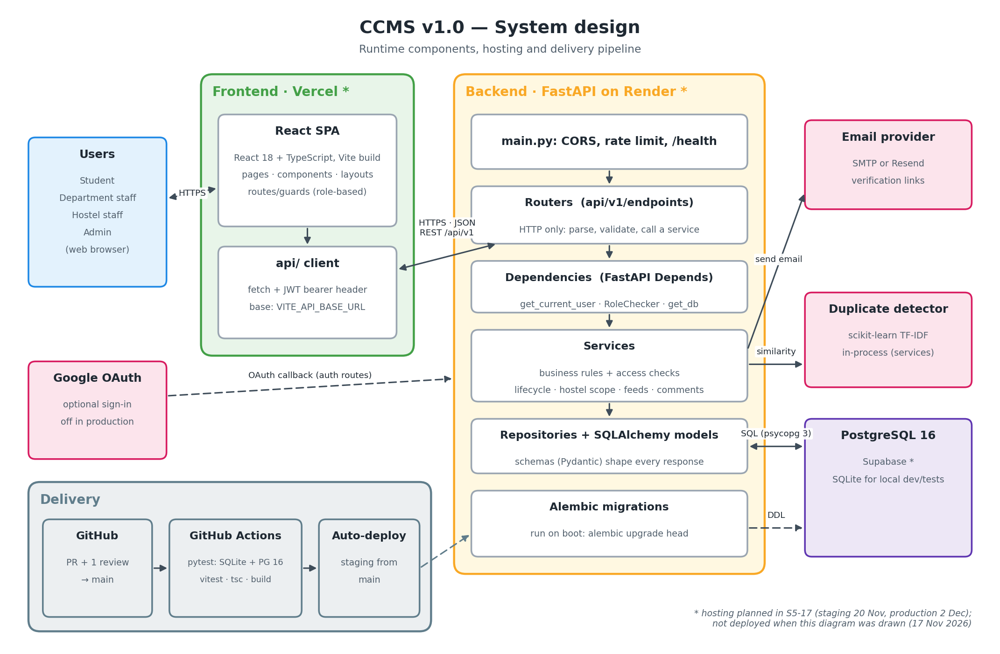
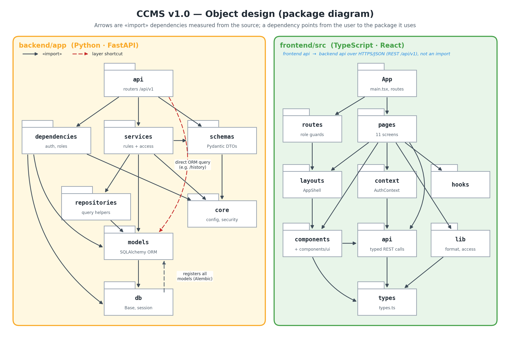

# CCMS v1.0 — System and object design (S5-28)

This document explains the two design diagrams in this folder:

| Diagram | File | Shows |
| --- | --- | --- |
| System design | [`system-design.png`](system-design.png) | Runtime components, external services, hosting and the delivery pipeline |
| Object design | [`object-design-package.png`](object-design-package.png) | Backend and frontend packages and their «import» dependencies |

Both images are generated by [`render_diagrams.py`](render_diagrams.py) (`python docs/architecture/render_diagrams.py`, needs only matplotlib), so they can be redrawn when the code changes instead of being edited by hand.

Drawn on 17 Nov 2026 from `main` at `7d7e6b7`. The hosting boxes (Vercel, Render, Supabase) are the plan for S5-17; nothing was deployed when the diagram was drawn. The class, sequence, state and activity diagrams are in [`uml/`](uml/) (S5-11).

---

## 1. System design

CCMS is a three-tier web application.

1. **Client — React single-page app.** Students, department staff, Hostel staff and admins use one React 18 + TypeScript app built with Vite. `routes/guards.tsx` shows each role only its own screens. That is a convenience, not security: every rule is enforced again by the backend. All HTTP calls go through `src/api/client.ts`, which adds `/api/v1` to `VITE_API_BASE_URL` and sends the JWT as a bearer token.
2. **Application — FastAPI backend.** One Python service. `main.py` sets up CORS, the auth rate limiter and the `/health` endpoints, then mounts the routers under `/api/v1`. A request passes through the layers in the diagram from top to bottom: router → dependencies → service → repositories/models. Pydantic schemas define every request and response body.
3. **Data — PostgreSQL.** PostgreSQL 16 in CI and in the hosted plan (Supabase); SQLite for local development and the fast test job. Alembic owns the schema; the Procfile runs `alembic upgrade head` on every boot, so a deploy cannot start on an out-of-date schema.

**External services**

| Service | Used for | Notes |
| --- | --- | --- |
| Email (SMTP or Resend) | Email-verification links at sign-up | `EMAIL_PROVIDER` picks the sender; tests use a mock sender, so no test sends real email |
| Google OAuth | Optional "Sign in with Google" | `GOOGLE_AUTH_ENABLED=false` in production |
| Duplicate detector | "Similar complaints" warning before submitting | scikit-learn TF-IDF + cosine similarity, run in-process by `duplicate_service`; not a separate server |

**Delivery.** Every change goes through a pull request with one reviewer. GitHub Actions runs the backend tests twice (SQLite, and PostgreSQL 16 for the race-condition tests) and the frontend tests, type check and build. Under the S5-17 plan, staging redeploys from `main` after every merge.

**Why this shape.** A single backend service and a static frontend are the smallest setup that meets the requirements: no message queue or second service to operate, and all three hosts give HTTPS by default (NFR-3). Keeping the duplicate detector in-process avoids a network hop and a second deployment for a model that fits in memory.

---

## 2. Object design (package diagram)

The arrows were taken from the real `import` statements in `backend/app` and `frontend/src` (test files excluded), not drawn from memory. An arrow from A to B means "A imports B".

### Backend packages (`backend/app`)

| Package | Responsibility | May depend on |
| --- | --- | --- |
| `api` | FastAPI routers (`api/v1/endpoints`). Turn HTTP into function calls: path/query parsing, status codes, `X-Total-Count`. No business rules. | `services`, `schemas`, `dependencies` |
| `dependencies` | Request-scoped dependencies: `get_current_user` (JWT → active `User`), `RoleChecker` (`require_student`, `require_staff`, …). | `core`, `db`, `models` |
| `services` | Business rules and access control: complaint lifecycle, hostel scope (S4-04), feeds and publication, residences, metrics, duplicates, comments. | `repositories`, `models`, `schemas`, `core` |
| `repositories` | Reusable query helpers (locations, residences, staff–hostel assignments). | `models` |
| `schemas` | Pydantic request/response models (DTOs). They decide exactly which fields leave the server. | `core` |
| `models` | SQLAlchemy ORM classes, one per table. | `db` |
| `db` | Declarative `Base`, engine and session (`get_db`). `db/base.py` imports every model so Alembic sees the full metadata; that is the dashed `db → models` arrow. | `models` (registration only) |
| `core` | Settings (`config.py`), password hashing and JWT (`security.py`), rate limiter. | — |

### Frontend packages (`frontend/src`)

| Package | Responsibility |
| --- | --- |
| `App` / `main.tsx` | Mounts the router and the auth provider |
| `routes` | Role guards that redirect a user away from screens their role cannot use |
| `pages` | One component per screen (login, register, raise complaint, my complaints, complaint detail, campus feed, staff dashboard, admin dashboard, profile, …) |
| `layouts` | Shared page chrome (`AppShell`, `AuthLayout`) |
| `components` | Reusable widgets (`ComplaintStatusTimeline`, `LocationPicker`, `DuplicateComplaintWarning`, `components/ui`) |
| `context` | `AuthContext`: the signed-in user and token |
| `hooks` | Shared React hooks |
| `api` | Typed functions, one module per backend area (`complaints.ts`, `staff.ts`, `admin.ts`, …) |
| `lib` | Pure helpers: formatting, role/access checks, config |
| `types` | Shared TypeScript types that mirror the backend schemas |

The frontend `api` package talks to the backend `api` package over HTTPS/JSON. That is a runtime call, not an import, so the two halves can be built, tested and deployed separately; `docs/API_CONTRACT.md` is the agreement between them.

---

## 3. Layering

Dependencies point one way: **router → service → repository/model → db**. A lower layer never imports a higher one: no service imports a router, and no model imports a service. In practice:

- A router does three things: let FastAPI validate the input, call one service function, and return its result.
- A service holds the rule and the transaction. For example, `complaint_lifecycle_service.update_department_complaint_status` checks the transition table, updates the complaint and writes the history row in one commit.
- Schemas sit beside the services rather than below them, because both routers (response models) and services (building responses) use them.

**Known shortcuts (honest state on 17 Nov).** Three routers still query the database directly instead of calling a service: `complaints.py` (the `/history` route), `admin_staff.py` and `staff_scope.py`. These are the red dashed arrow in the package diagram. They work and are tested, but they are the first place to refactor: their access checks would be easier to reuse if they lived in a service.

---

## 4. Why access checks live in the service layer

Every privacy rule in CCMS is an access check: a student sees only their own complaints, staff see only their department, Hostel staff see only their assigned hostels, and so on. These checks are in services, not routers, for four reasons.

1. **One rule, many routes.** The same complaint is reachable from its detail page, the status update, the history and the comments. If each router wrote its own check, one would drift. Instead, each route family calls one loader: for staff, `staff_service._get_department_complaint` (department + hostel scope), used by both the detail and the status-update routes. S5-05 (Comments) makes this explicit: it names the two loaders `complaint_service.load_owned_complaint` (student owner) and `staff_service.load_department_complaint` (staff), and the comment routes call those same functions, so comments can never see more than the matching detail page.
2. **Fail closed in SQL.** `hostel_scope_service.get_staff_scope` + `apply_scope` add the scope to the database query itself. An out-of-scope row is never loaded, so it cannot leak through a later code path, and "not found" and "not allowed" are the same `404`. That is why guessing complaint IDs reveals nothing.
3. **Testable without HTTP.** Service functions take a session and a user, so tests such as `test_hostel_scope_service.py` check the rules directly as well as through the API.
4. **Routers stay thin.** Role checks that depend only on the token (`require_student`, `require_staff`) stay as FastAPI dependencies; anything that depends on the data (which department, which hostel, who owns it) goes in the service.

---

## 5. Design patterns used

| Pattern | Where | Why |
| --- | --- | --- |
| **Layered architecture** | `api` → `services` → `repositories`/`models` → `db` | Each layer can change without touching the others; see section 3 |
| **Service layer** | `app/services/*_service.py` | Business rules and transactions in one place, reused by every route that needs them |
| **Repository** | `app/repositories/` (locations, residences, staff–hostel assignments) | Queries used by several services are written once and keep SQL details out of the rules. Simple one-off queries stay in the service; we did not wrap every table in a repository |
| **Dependency injection** | FastAPI `Depends`: `get_db`, `get_current_user`, `require_student` / `require_staff` / `require_admin` | Routers declare what they need instead of creating it. Tests replace `get_db` with an in-memory SQLite session through `app.dependency_overrides`, with no change to app code |
| **Data Transfer Object** | `app/schemas` (Pydantic) | The response model is the allow-list of fields that leave the server. This is how feeds never return `description` or reporter identity, and comments never return email or user id |
| **Strategy** | `email_service`: `SmtpEmailSender`, `ResendEmailSender`, `MockEmailSender` behind one `EmailSender` interface | The provider is chosen by configuration; tests use the mock |
| **State machine (transition table)** | `STAFF_ALLOWED_TRANSITIONS` in `complaint_lifecycle_service` | Allowed status changes are data, so adding Reject (S5-03) is one table edit plus tests, not new branching code |
| **Migrations as code** | Alembic `versions/0001`–`0014` (0015+ in Sprint 5) | Schema changes are reviewed, ordered and reversible; tests check that the migrated schema matches the ORM |
