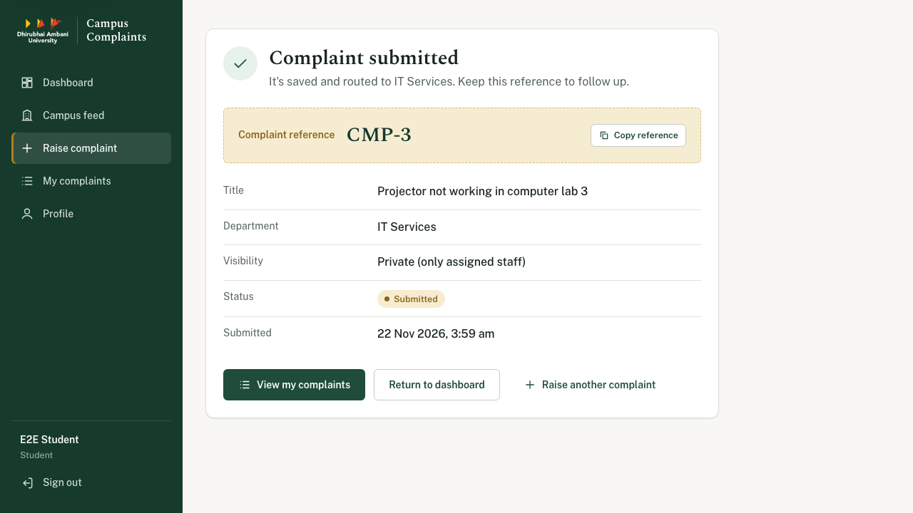
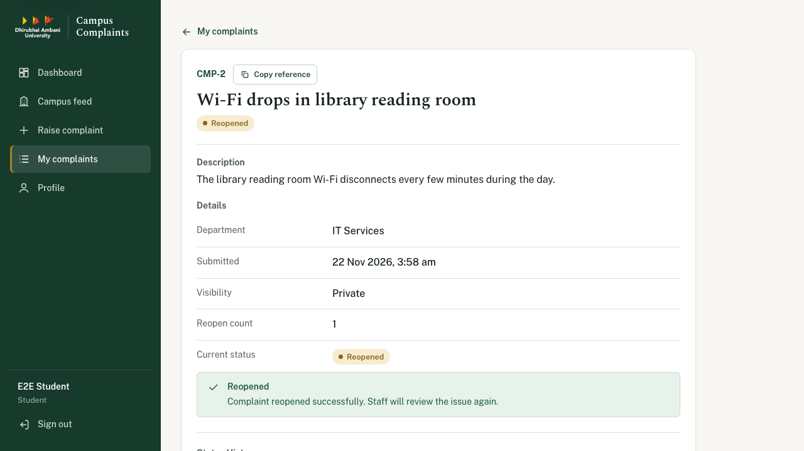
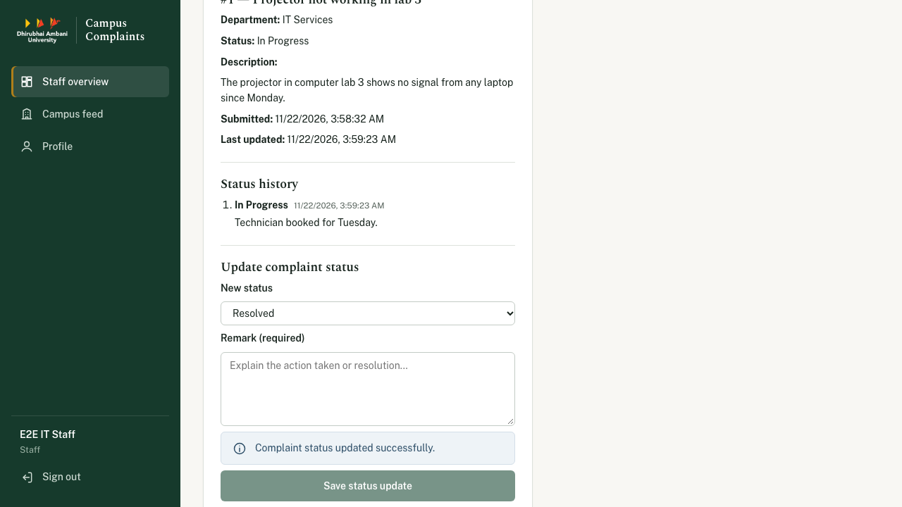
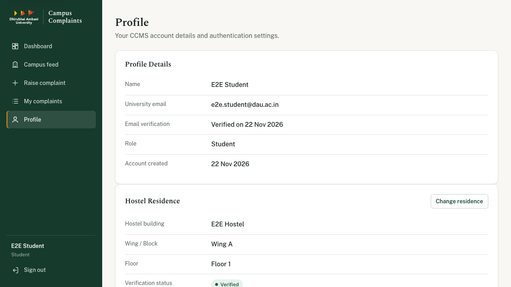
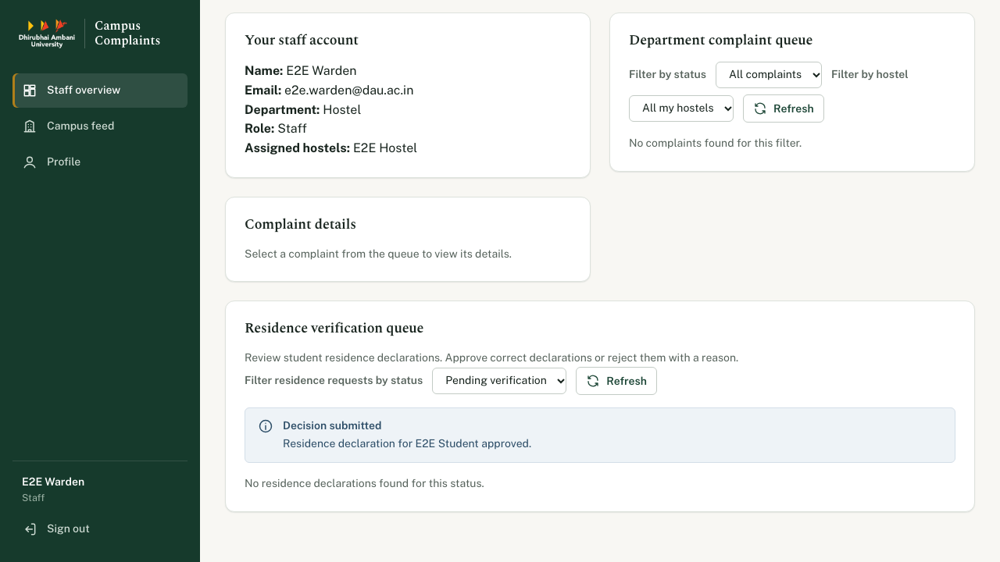
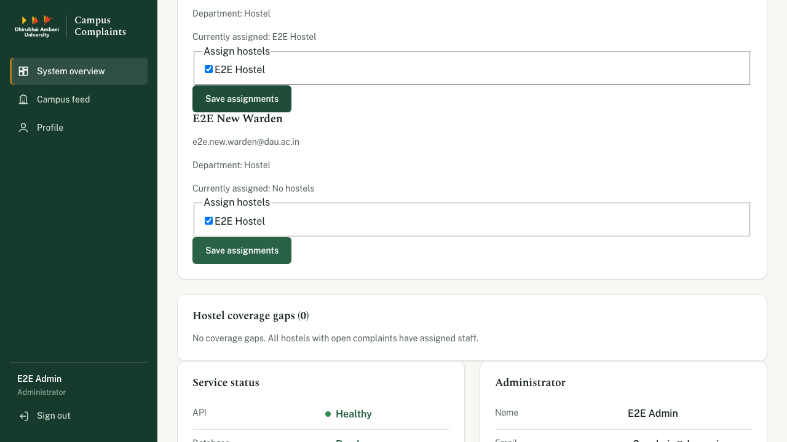
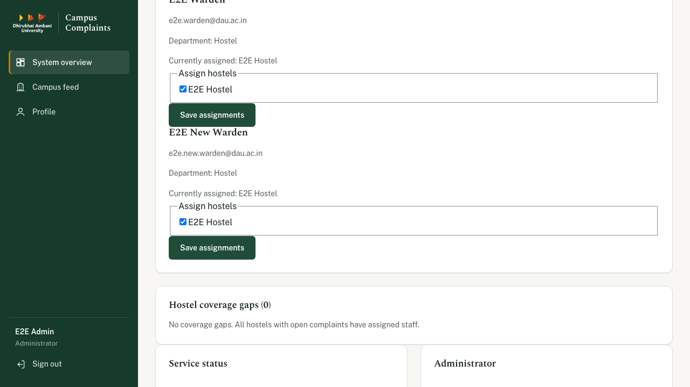

# GUI / End-to-End Testing Report (S5-35)

Owner: Yashvi (S5-35 handed over from Utkarsh by Taksh on 22 Nov 2026) · Reviewer: Dev

This report lists only runs that actually happened, with their commit and environment.

## 1. Approach

The tests drive a real browser through the real React app and the real FastAPI backend. Nothing is mocked: every click sends real HTTP requests to the API, which reads and writes a real database. That is the difference from the existing frontend unit tests (`frontend/src/test`), which replace the API with mocks.

- **Tool:** Playwright `1.48.2` (`e2e/`), kept apart from `frontend/` so its dependencies and CI are unchanged.
- **Data:** every run starts the backend on a new SQLite file (`backend/e2e.db`). `alembic upgrade head` creates it, `seed_departments` and `e2e/seed_e2e.py` fill it, and then the API starts. Seed accounts use a test-only password and exist nowhere else.
- **Sign-in:** each role signs in once (`auth.setup.ts`) and the session is reused, because the API allows 15 auth requests per minute per IP.
- **Run it:**
  ```bash
  cd e2e && npm install && npx playwright install chromium
  npx playwright test            # or: E2E_BROWSER_CHANNEL=chrome npx playwright test
  ```

## 2. Environment of the recorded runs

| Item | Value |
| --- | --- |
| Date | 22 Nov 2026 |
| Branch / commit | Runs 1–2: `sprint-5/yashvi-s5-35-gui-tests` @ `2d14350` (based on `main` @ `7f64a8b`). Run 3: @ `e8aa0b5`, after merging `main` @ `5594351` (includes #120) |
| Backend | FastAPI via uvicorn on `127.0.0.1:8010`, SQLite `e2e.db`, `EMAIL_PROVIDER=mock` |
| Frontend | Vite dev server on `127.0.0.1:5180` |
| Browser | Google Chrome 157 (Playwright `channel: chrome`), 1280×720, macOS |
| Not run on | staging. See section 6 |

## 3. Results

| # | Flow | Test | Run 1: before fix | Run 2: fix applied locally | Run 3: after #120 merged |
| --- | --- | --- | --- | --- | --- |
| 1 | Login and register | New student registers and is sent to sign in with the "Account created" message | ✅ Pass | ✅ Pass | ✅ Pass |
| 2 | Login and register | Wrong password shows an error and stays on `/login` | ✅ Pass | ✅ Pass | ✅ Pass |
| 3 | Login and register | Signed-in student lands on `/dashboard` | ✅ Pass | ✅ Pass | ✅ Pass |
| 4 | Raise complaint | Text similar to an existing complaint shows **"Similar complaints already reported"** with that complaint; submitting still works and shows a reference | ✅ Pass | ✅ Pass | ✅ Pass |
| 5 | Raise complaint | Unrelated text shows no duplicate warning | ✅ Pass | ✅ Pass | ✅ Pass |
| 6 | Student tracking | My complaints lists both seeded complaints; search "projector" narrows to one | ✅ Pass | ✅ Pass | ✅ Pass |
| 7 | Reopen | Resolved complaint reopened with a reason; status shows Reopened and the button disappears | ✅ Pass | ✅ Pass | ✅ Pass |
| 8 | Staff status update | IT staff open a complaint; Save is disabled until a remark is typed; In progress is saved | ✅ Pass | ✅ Pass | ✅ Pass |
| 9 | Staff scope | Hostel staff do not see an IT Services complaint | ✅ Pass | ✅ Pass | ✅ Pass |
| 10 | Residence | Student declares hostel, wing and floor → Pending; assigned Hostel staff approve → student sees Verified | ✅ Pass | ✅ Pass | ✅ Pass |
| 11 | Admin assignment | Admin ticks a hostel for a Hostel staff member and saves; the assignment persists after reload | ❌ **Fail** | ✅ Pass | ✅ Pass |
| 12 | Admin | Hostel coverage gaps panel is shown | ✅ Pass | ✅ Pass | ✅ Pass |
| | **Total** (plus 4 sign-in setup steps, all passed) | | **15 / 16 passed** | **16 / 16 passed** | **16 / 16 passed** |

Run 2 is the same commit with `backend/app/main.py` taken from the fix branch, to confirm the fix in a real browser. Run 3 is after #120 was merged into `main` and `main` was merged into this branch. In Run 3, test 11 also checks that the card shows "Currently assigned: E2E Hostel" after the reload.

## 4. Defect found

**Admin "Save assignments" never reaches the API: CORS rejects PUT** (test 11). **Status: fixed, #120 merged 22 Nov 2026 (`5594351`).**

- **What happens:** the admin ticks a hostel and chooses **Save assignments**. No success message appears, and after a reload the staff member still has "No hostels" (screenshot 6).
- **Cause:** the frontend saves with `PUT /api/v1/admin/staff/{id}/hostels`, but `main.py` allowed only `GET, POST, PATCH, OPTIONS, HEAD` in CORS. The browser's preflight for PUT got **HTTP 400**, so it never sent the request. A preflight for PATCH on the same URL got 200.
- **Where it applies:** whenever the SPA and the API are on different origins, which means local development (two ports) and staging/production (Vercel + Render). Backend tests call the API directly and frontend tests mock it, so neither could catch this.
- **Fix:** PR #120 (`sprint-5/yashvi-fix-cors-put`) adds `PUT` to `allow_methods`. It also adds `backend/tests/test_cors_methods.py`, which preflights every method the API serves, so a new method cannot be forgotten again. Full backend suite on that branch: 901 passed, 8 skipped, 0 failed. With the fix, test 11 passes (Runs 2 and 3, screenshot 7).

## 5. Screenshots (1–6 from Run 1, 7 from Run 3)

| | |
| --- | --- |
|  1. Complaint submitted (test 4) |  2. Complaint reopened (test 7) |
|  3. Status updated with remark and history (test 8) |  4. Student sees Verified (test 10) |
|  5. Hostel staff decision submitted (test 10) |  6. Defect: assignment not saved (test 11, Run 1) |
|  7. After the fix: "Currently assigned: E2E Hostel" (test 11, Run 3) | |

## 6. Not covered yet

| Item | Why | Plan |
| --- | --- | --- |
| Reject (S5-03/04), Comments UI (S5-06), Feedback (S5-08/09) | Not merged yet, so there are no screens to test | Add a spec per feature once merged; final run by Tue 1 Dec |
| Run on staging | Needs the seed accounts on the staging database (Rushil, S5-18), and `E2E_BASE_URL` set to the Vercel URL | Final run against staging by Tue 1 Dec, recorded here with its commit |
| Selenium IDE `.side` recordings | The plan names Selenium IDE (Playwright optional). Recordings are made in the Selenium IDE browser extension | Record the same flows in Selenium IDE into `docs/testing/selenium/` |
| Other browsers | Only Chrome was run | Optional: add Firefox/WebKit projects to `playwright.config.ts` |
