# CCMS User Manual

Campus Complaint Management System (CCMS) for Dhirubhai Ambani University. This manual explains how students, staff and administrators use the web app.

> **About the screenshots.** They were taken from a local run of the app with the Sprint 3 demo seed and a few extra demo staff accounts, at a 1280 × 800 window. Staging (S4-10) was not ready when this was written. Names, emails and complaints in them are demo data. The staff screens show the hostel-scoped dashboard from S4-14.

## Contents

1. [Roles at a glance](#1-roles-at-a-glance)
2. [Getting started](#2-getting-started)
3. [Students](#3-students)
4. [Staff](#4-staff)
5. [Administrators](#5-administrators)
6. [Complaint statuses](#6-complaint-statuses)
7. [Privacy](#7-privacy)
8. [Troubleshooting](#8-troubleshooting)

## 1. Roles at a glance

| Role | Who | What they can do |
| --- | --- | --- |
| **Student** | Anyone who registers with a university email | Raise complaints, track and reopen their own complaints, declare their hostel residence, read the campus feed |
| **Staff** | Department staff, created by the CCMS team | Work on complaints in their own department; Hostel staff also verify residence declarations for their assigned hostels |
| **Admin** | Campus administrators | See complaint metrics for the whole campus, service status, and every department |

The left-hand menu changes with your role. Students see **Dashboard, Campus feed, Raise complaint, My complaints, Profile**. Staff see **Staff overview, Campus feed, Profile**. Administrators see **System overview, Campus feed, Profile**.

## 2. Getting started

### 2.1 Create a student account

1. Open the app and choose **Create a student account** on the sign-in page.
2. Enter your name, your university email (it must end in `@dau.ac.in`) and a password.
3. Open the verification link sent to your email. You can sign in only after verifying.
4. If the email did not arrive, use **Resend verification email** on the sign-in page.

Staff and administrator accounts are not self-registered. The CCMS team creates them.

### 2.2 Sign in

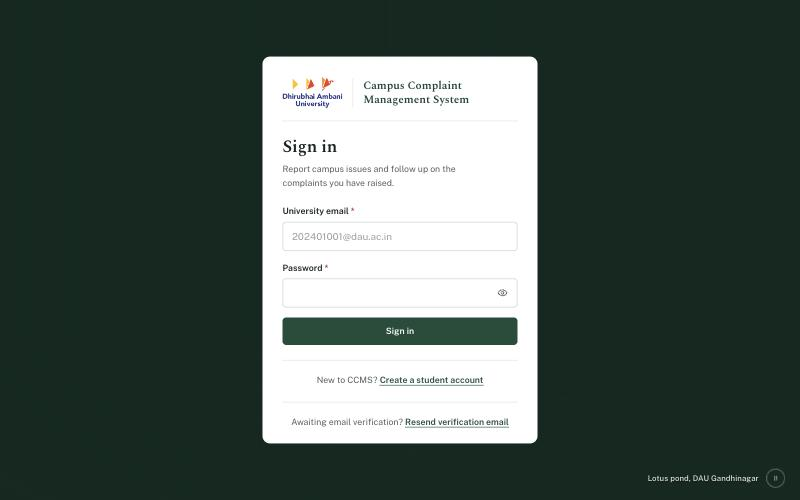

Enter your university email and password and choose **Sign in**. When Google sign-in is enabled on your deployment, a **Sign in with Google** button also appears. You land on your role's home page. If you opened a link to a page before signing in, CCMS takes you back there afterwards, provided your role may open it.

To sign out, use **Sign out** at the bottom of the left-hand menu.

## 3. Students

### 3.1 Dashboard

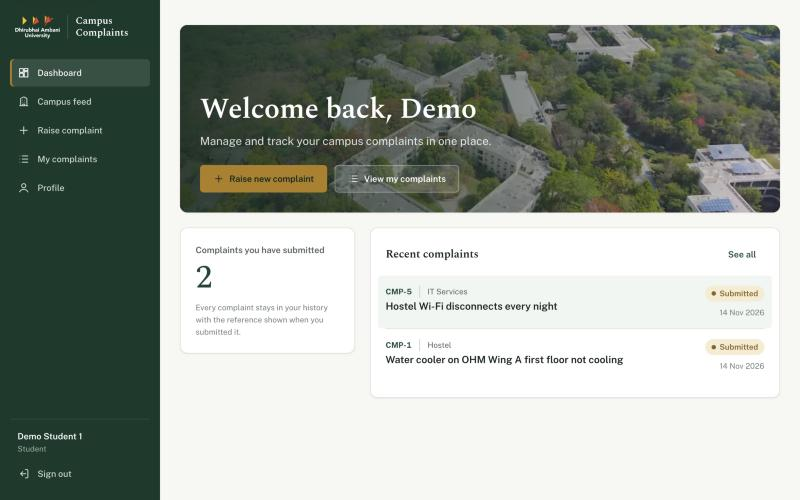

The dashboard shows how many complaints you have submitted and your most recent ones. Use **Raise new complaint** to report an issue, or **View my complaints** for your full history.

### 3.2 Raise a complaint

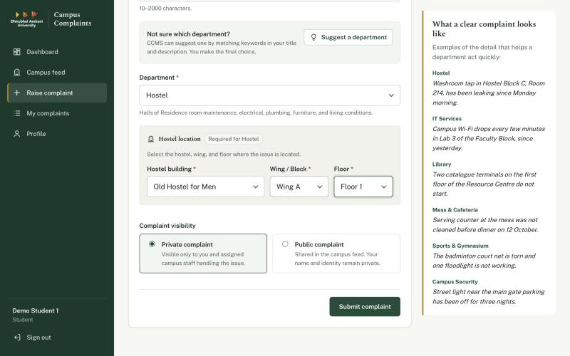

1. Write a **title** (3–120 characters) and a **description** (10–2000 characters). Say what is wrong, exactly where, and since when.
2. Choose the **department**. If you are unsure, **Suggest a department** proposes one from keywords in your text. The suggestion is advice only; you make the final choice.
3. For **Hostel** complaints, pick the **hostel building**, **wing / block** and **floor**. All three are required, and the wing and floor lists only show options for the hostel you picked.
4. Choose the **visibility**:
   - **Private**: only you and the staff handling it can see it.
   - **Public**: shared on the campus feed. Your name, email and roll number are never shown.
5. While you type, CCMS may warn that **similar complaints** already exist. Read them first: if one describes your issue, you may not need a new complaint.
6. Choose **Submit complaint**.

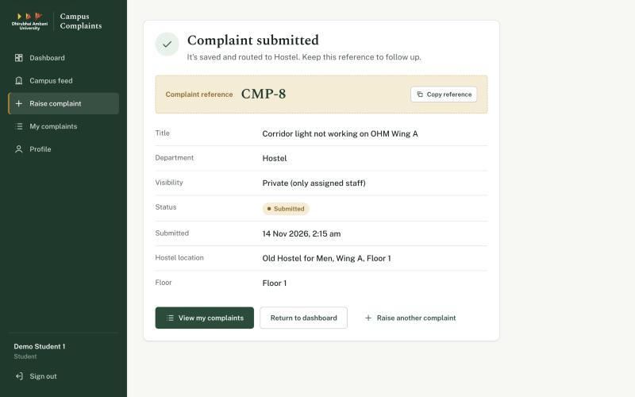

You get a **complaint reference** (for example `CMP-8`). Keep it: staff use it to find your complaint. **Copy reference** copies it to the clipboard.

### 3.3 My complaints

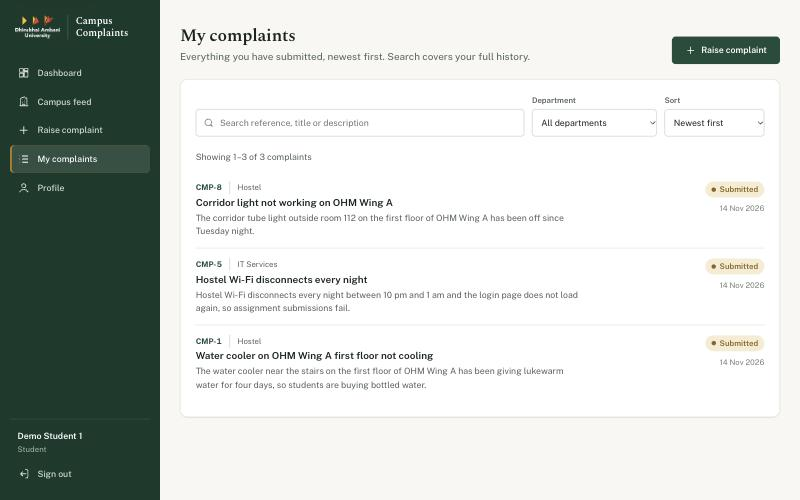

Lists every complaint you have submitted, newest first. You can:

- **Search** by reference, title or description.
- Filter by **department**.
- **Sort** newest or oldest first.

Select a complaint to open it.

### 3.4 Complaint details and reopening

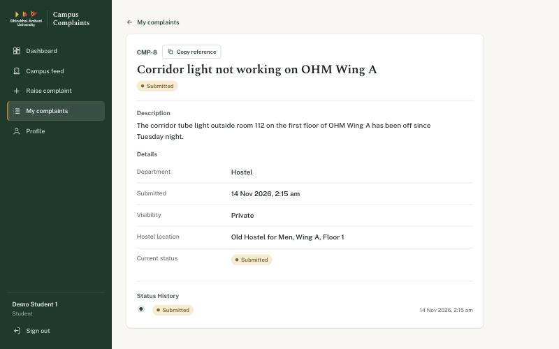

The detail page shows the description, department, visibility, hostel location, current status and the full **status history**, including the remarks staff added at each step.

If a complaint was **resolved** but the problem came back, you can **reopen** it from this page:

- within **7 days** of it being resolved, and
- at most **twice** per complaint.

Add a short remark explaining what is still wrong. The complaint returns to the department as **Reopened**.

### 3.5 Campus feed

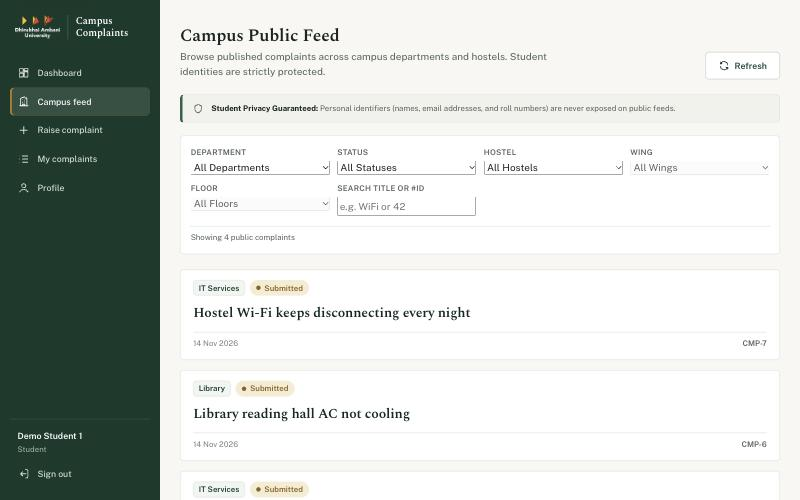

The campus feed lists **published public complaints** across departments and hostels. Filter by department, status, hostel, wing and floor, or search by title or `#ID`. Student identities are never shown on the feed.

Public **Hostel** complaints are published automatically when they come from a verified resident of that hostel. Other public Hostel complaints wait for Hostel staff or an administrator to review them before they appear. Public complaints for other departments are published directly.

### 3.6 Profile and hostel residence

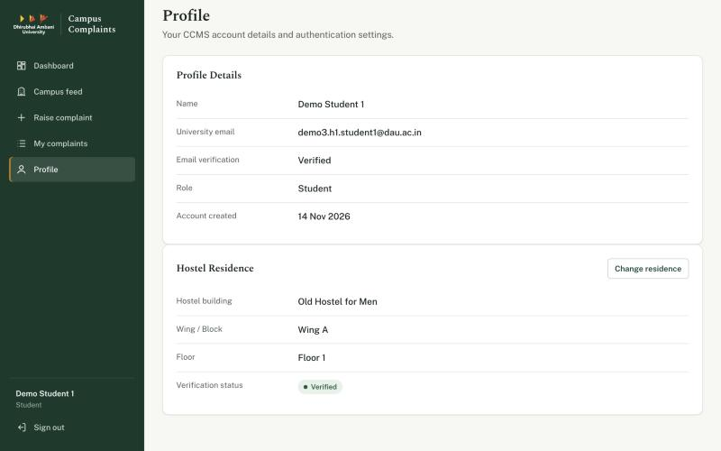

The profile shows your account details and your **hostel residence**:

1. Choose **Declare residence** (or **Change residence**) and pick your hostel, wing and floor.
2. Choose **Save residence**. Its status becomes **Pending** until Hostel staff for that hostel review it.
3. When they approve it, the status becomes **Verified**. If they reject it, their remark is shown; correct your residence and save it again.

Changing a verified residence sends it back to **Pending**, and the earlier decision no longer applies.

## 4. Staff

### 4.1 Staff overview

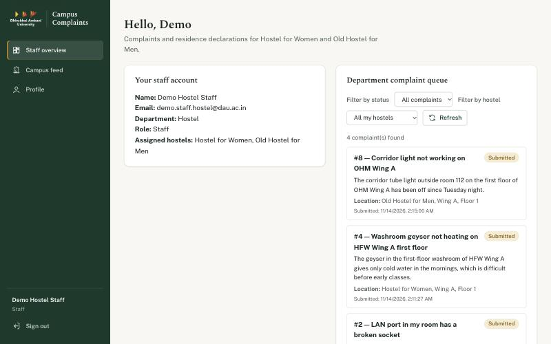

**Your staff account** shows your department. You see only complaints for **your department**.

**Hostel department staff** work only on the hostels assigned to them:

- The header and **Assigned hostels** show which hostels you cover.
- The complaint queue and the residence queue contain only those hostels.
- **Filter by hostel** lists only your hostels. **All my hostels** shows all of them together.
- Hostel assignments are set by an administrator. If yours look wrong, contact an administrator.

Staff in other departments (IT Services, Library and so on) see their whole department's queue and no hostel filter.

### 4.2 Work on a complaint

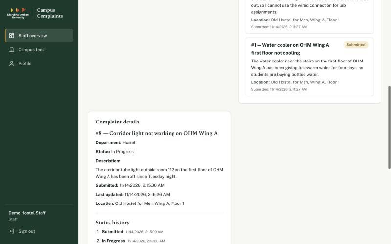

1. Use **Filter by status** (and **Filter by hostel** for Hostel staff) to narrow the queue. The queue shows 20 complaints per page; use **Previous** and **Next** to move between pages.
2. Select a complaint to see its details, location and status history. Reopened complaints are marked **Reopened complaint**.

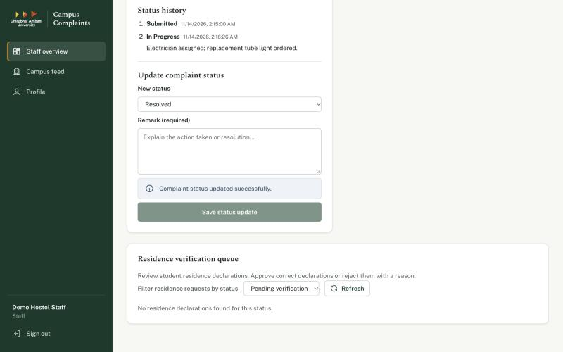

3. Under **Update complaint status**, choose the next status: a **Submitted** or **Reopened** complaint moves to **In progress**, and an **In progress** complaint moves to **Resolved**.
4. Enter a **remark** (required, up to 2000 characters). The student sees it in the status history.
5. Choose **Save status update**. The queue and history refresh.

If CCMS says a complaint is **not in your assigned hostels**, your hostel assignments changed after the queue loaded. Choose **Refresh** to reload the queue.

### 4.3 Verify residence declarations (Hostel staff)

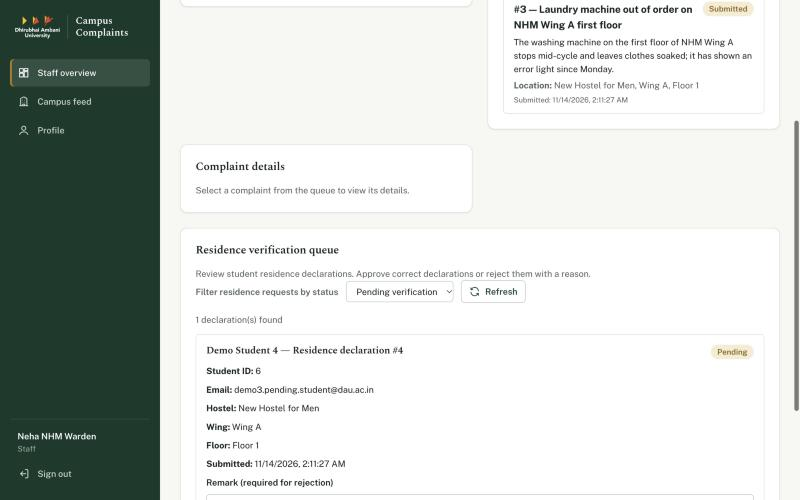

The **Residence verification queue** lists students' residence declarations for your hostels.

1. Use the status filter to see **Pending verification**, **Verified** or **Rejected** declarations.
2. For a pending declaration, check the student's hostel, wing and floor.
3. Choose **Approve residence**, or **Reject residence** with a remark explaining why (required for rejection).

If another staff member decided it first, CCMS tells you it has already been decided; refresh the queue.

### 4.4 No hostels assigned yet

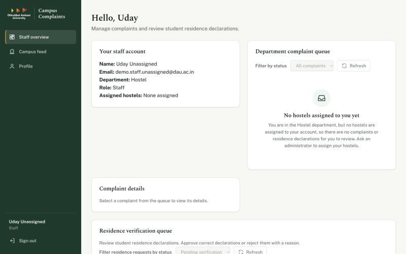

A Hostel staff member with no assigned hostels sees **No hostels assigned to you yet**, and both queues are empty. Ask an administrator to assign your hostels, then sign in again or reload the page.

## 5. Administrators

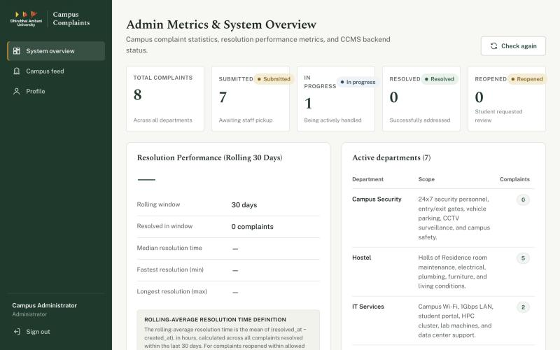

The **System overview** page shows:

- **Complaint statistics by status**: total, submitted, in progress, resolved and reopened, across all departments.
- **Resolution performance (rolling 30 days)**: how many complaints were resolved in the window, and the median, fastest and longest resolution times.
- **Active departments**: each department's scope and its number of complaints.
- **Service status**: whether the API and database are healthy, plus the version and environment. Use **Check again** to refresh.

Administrators can also open the **Campus feed**, which shows every published complaint.

## 6. Complaint statuses

| Status | Meaning | Who changes it |
| --- | --- | --- |
| **Submitted** | New, waiting for staff | Set when a student submits |
| **In progress** | Staff are working on it | Staff, with a remark |
| **Resolved** | Staff consider it fixed | Staff, with a remark |
| **Reopened** | The student says the problem is back (within 7 days, at most twice) | Student, then staff move it to In progress again |

Residence declarations are **Pending**, **Verified** or **Rejected**.

## 7. Privacy

- Public complaints never show the student's name, email or roll number.
- Private complaints are visible only to the student and the staff handling them.
- Staff see only their own department's complaints; Hostel staff see only their assigned hostels. Items outside your scope behave as if they do not exist.

## 8. Troubleshooting

| Problem | What to do |
| --- | --- |
| Cannot sign in after registering | Open the verification link in your email first, or use **Resend verification email** |
| "Use your university email" when registering | Register with your `@dau.ac.in` address |
| No wing or floor options when raising a Hostel complaint | Pick the hostel building first, then the wing |
| Cannot reopen a resolved complaint | Reopening is allowed only within 7 days of resolution and at most twice |
| Staff: "No hostels assigned to you yet" | Ask an administrator to assign your hostels |
| Staff: "not in your assigned hostels" | Your assignments changed; choose **Refresh** |
| A page shows "Couldn't load …" | Check your connection and use **Try again**; if it continues, contact the CCMS team |
